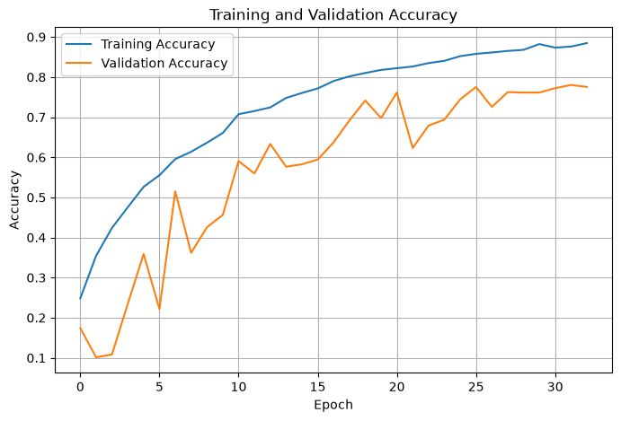
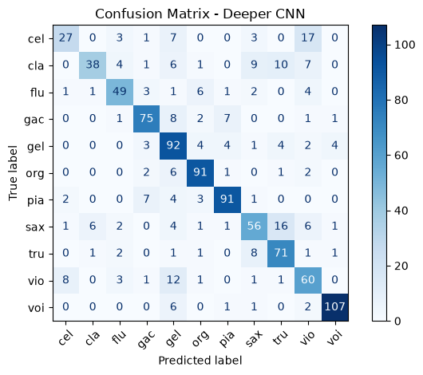
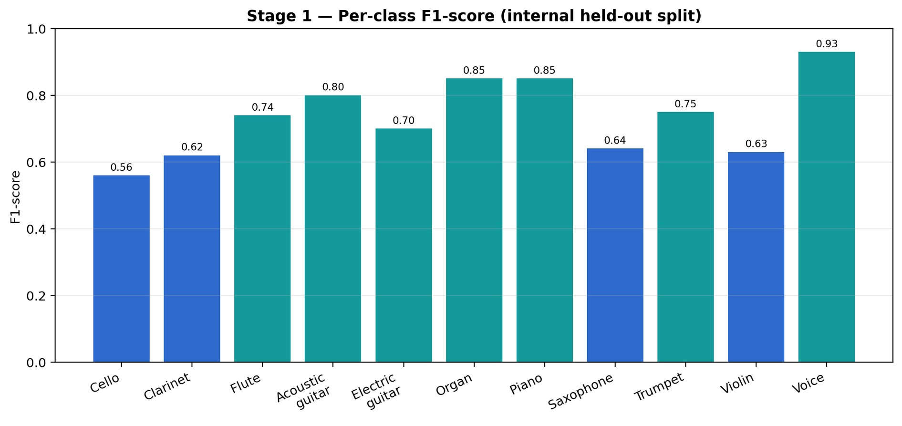
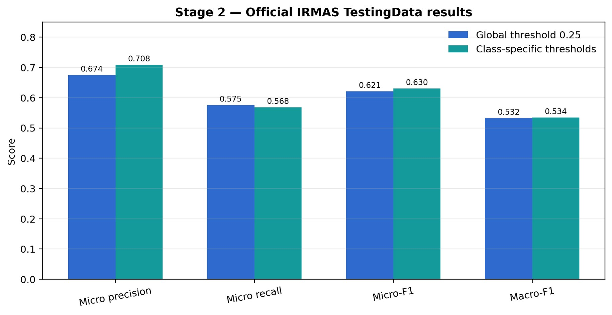

# Musical Instrument Recognition Using DSP and Machine Learning

A two-stage CNN-based system for recognizing musical instruments from audio recordings using Digital Signal Processing (DSP) and Mel-spectrogram features.

The project performs both **predominant instrument classification** and **multilabel instrument recognition**, where multiple instruments may be present in the same recording.

## Project Overview

Musical recordings contain complex audio signals with overlapping frequency components. This project transforms audio signals into Mel-spectrogram representations and uses Convolutional Neural Networks (CNNs) to recognize musical instruments.

The system consists of two stages:

- **Stage 1 — Single-Instrument Classification:** Predicts the predominant instrument in an audio recording.
- **Stage 2 — Multilabel Instrument Classification:** Identifies multiple instruments that may be present simultaneously.

## System Workflow

```text
Audio Recording
      │
      ▼
Audio Preprocessing
      │
      ▼
Mel-Spectrogram Extraction
      │
      ├─────────────────────────────┐
      ▼                             ▼
Stage 1: Deeper CNN             Stage 2: Multilabel CNN
      │                             │
      ▼                             ▼
Predominant Instrument           Multiple Instrument Labels
Classification                   with Confidence Scores
```

## Dataset

The project uses the **IRMAS (Instrument Recognition in Musical Audio Signals) dataset**.

- **Original dataset:** [IRMAS Dataset — Zenodo](https://doi.org/10.5281/zenodo.1290750)
- **Processed dataset:** Available through the link provided in [`data/README.md`](data/README.md).

The processed dataset is hosted separately due to its size.

## DSP and Feature Extraction

Audio signals are processed and represented as Mel-spectrograms before being passed to the CNN models.

The project uses:

- Audio sampling rate: 22,050 Hz
- Short-Time Fourier Transform (STFT)
- 2,048-point FFT
- 512-sample hop length
- Hann window
- 128 Mel frequency bands

Mel-spectrograms provide a time-frequency representation of audio, allowing the CNN to learn instrument-specific spectral patterns.

## Model Architecture

### Stage 1 — Predominant Instrument Classification

A deeper CNN is trained to classify the predominant instrument in an audio recording.

| Metric | Result |
|---|---:|
| Test Accuracy | 75.25% |
| Test Loss | 0.7513 |
| Test Samples | 1,006 |

### Stage 2 — Multilabel Instrument Classification

A multilabel CNN is trained to identify multiple instruments in a recording and evaluated on the official IRMAS testing dataset.

| Metric | Result |
|---|---:|
| Micro-F1 Score | 0.6208 |
| Test Samples | 2,874 |

Detailed metrics, threshold analysis, and visualizations are available in [`results/README.md`](results/README.md).

## Results and Visualizations

### Stage 1 — Training and Validation Accuracy



### Stage 1 — Confusion Matrix



### Stage 1 — Per-Class F1 Score



### Stage 2 — Official IRMAS Test Metrics



For additional evaluation figures, visit the [`results/`](results/) directory.

## Repository Structure

```text
mohakgupta1411-musical-instrument-recognition-using-dsp-and-ml/
│
├── README.md
├── requirements.txt
│
├── data/
│   └── README.md
│
├── docs/
│   ├── Project Presentation.pdf
│   ├── Project Report with attached base paper.pdf
│   └── Project Synopsis.pdf
│
├── models/
│   ├── README.md
│   ├── best_cnn_deep.keras
│   └── best_cnn_multilabel_v2.keras
│
├── notebooks/
│   ├── Musical_Instrument_Recognition.ipynb
│   ├── Final_Project_Demonstration.ipynb
│   └── README.md
│
└── results/
    ├── README.md
    ├── stage1_confusion_matrix.jpeg
    ├── stage1_per_class_f1_score.jpeg
    ├── stage1_training_validation_accuracy.jpeg
    ├── stage1_training_validation_loss.jpeg
    ├── stage2_f1_by_number_of_instruments.jpeg
    ├── stage2_official_irmas_test_metrics.jpeg
    ├── stage2_threshold_strategy_comparison.jpeg
    └── stage2_validation_threshold_sweep.png
```

## Installation

Clone the repository:

```bash
git clone https://github.com/YOUR-USERNAME/mohakgupta1411-musical-instrument-recognition-using-dsp-and-ml.git
cd mohakgupta1411-musical-instrument-recognition-using-dsp-and-ml
```

Install the required Python packages:

```bash
pip install -r requirements.txt
```

Launch Jupyter Notebook:

```bash
jupyter notebook
```

Open `Musical_Instrument_Recognition.ipynb` from the `notebooks/` directory to explore the complete workflow.

For a quick demonstration of the trained models, open `Final_Project_Demonstration.ipynb`.

## Requirements

The project uses Python and the following libraries:

- NumPy
- Pandas
- Matplotlib
- Seaborn
- Scikit-learn
- Librosa
- TensorFlow / Keras
- Jupyter Notebook

Refer to [`requirements.txt`](requirements.txt) for the package list.

## Project Documentation

- [Project Presentation](docs/Project%20Presentation.pdf)
- [Project Report with Attached Base Paper](docs/Project%20Report%20with%20attached%20base%20paper.pdf)
- [Project Synopsis](docs/Project%20Synopsis.pdf)
- [Complete Project Notebook](notebooks/Musical_Instrument_Recognition.ipynb)
- [Interactive Project Demonstration](notebooks/Final_Project_Demonstration.ipynb)
- [Notebook Documentation](notebooks/README.md)
- [Model Details](models/README.md)
- [Dataset Details](data/README.md)
- [Results and Performance](results/README.md)

## Future Scope

- Improve multilabel instrument recognition performance.
- Explore advanced CNN architectures.
- Evaluate the system on a wider range of musical genres and recording conditions.
- Develop a user-friendly interface for audio-based instrument prediction.

## Acknowledgements

We acknowledge the creators of the IRMAS dataset for providing the audio data used in this project.

## License

This repository is intended for academic and educational purposes. Please refer to the original IRMAS dataset terms before redistributing the dataset.
