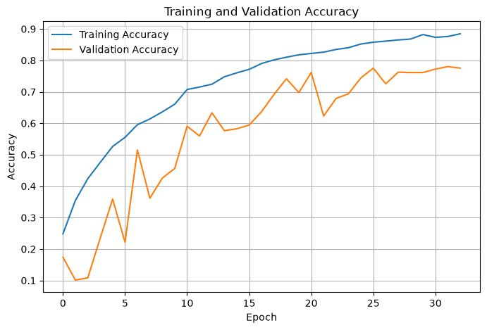
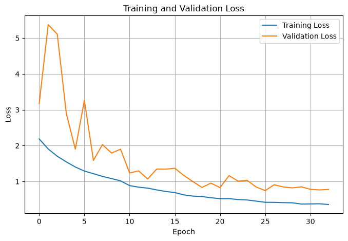
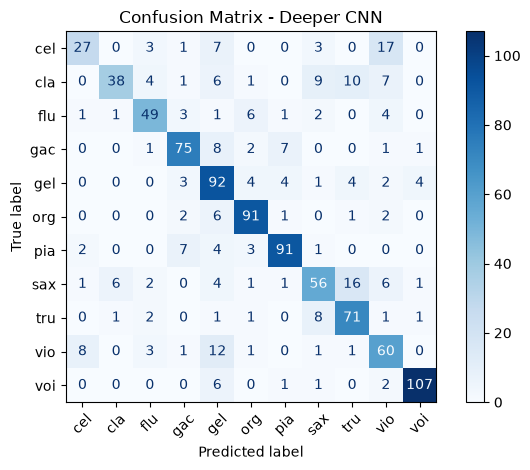
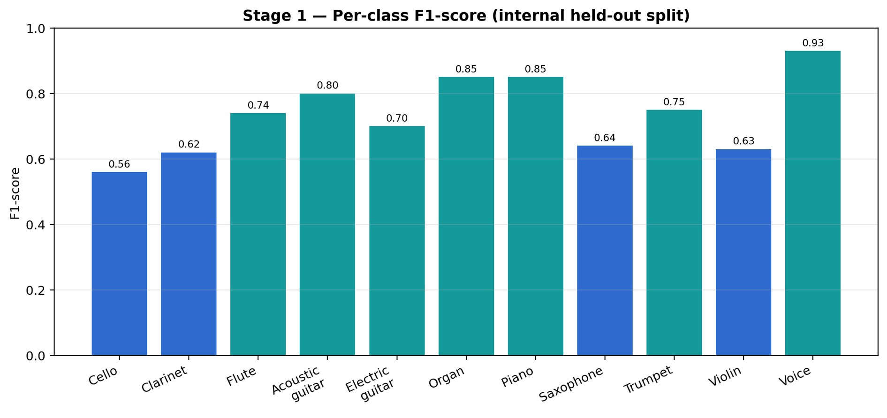
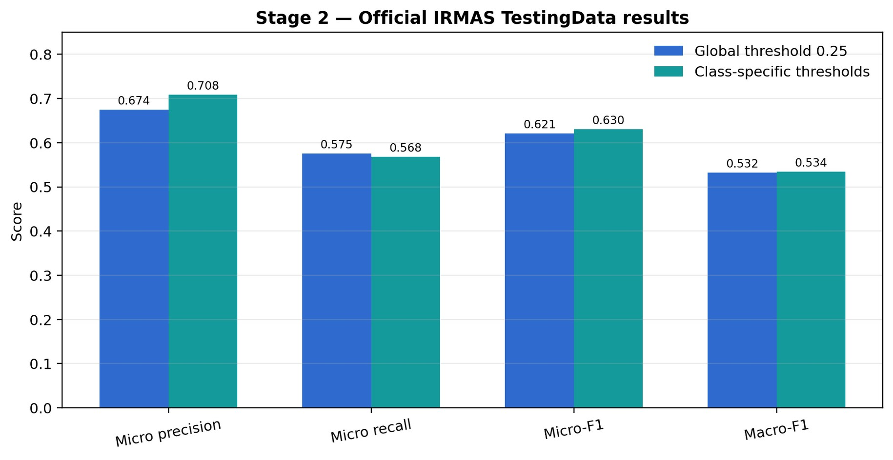
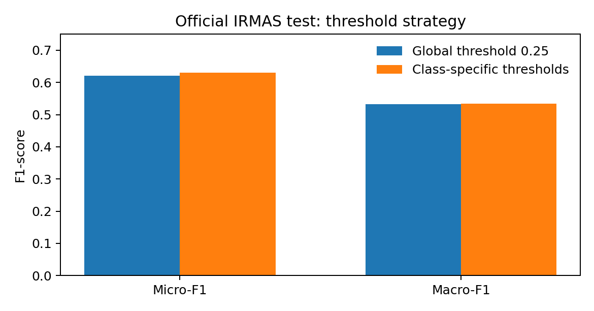
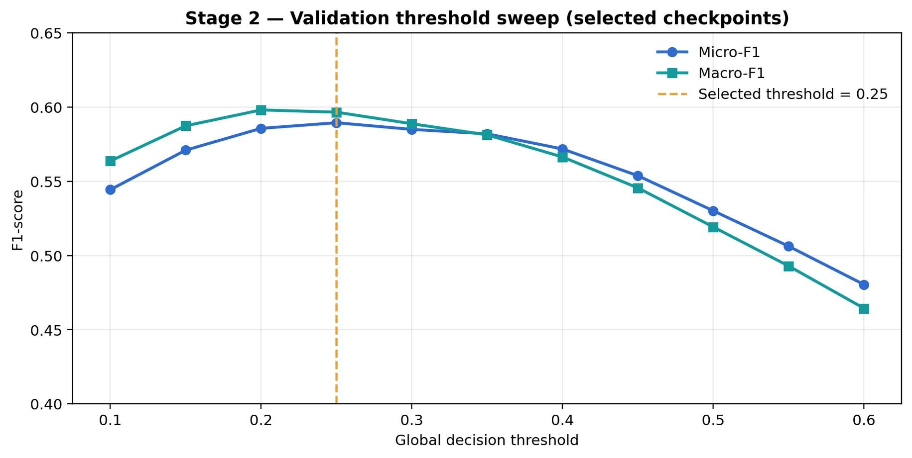
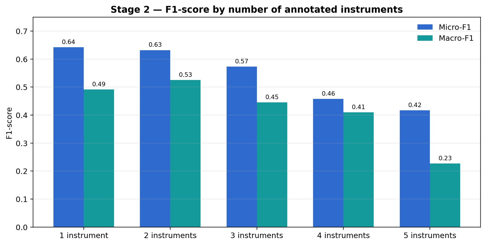

# Results and Performance

This directory contains the experimental results and performance evaluation of the CNN-based Musical Instrument Recognition system using Mel-spectrogram representations of audio signals.

## 1. Stage 1 — Single-Instrument Classification

The deeper CNN model predicts the predominant musical instrument present in an audio recording.

### Model Performance

| Metric | Result |
|---|---:|
| Test Accuracy | 75.25% |
| Test Loss | 0.7513 |
| Test Samples | 1,006 |

### Training and Validation Performance

The following plots show the model's accuracy and loss during training.

### Classification Evaluation

The confusion matrix illustrates the classification performance across instrument classes. The per-class F1-score plot highlights the model's performance for individual instruments.

## 2. Stage 2 — Multilabel Instrument Classification

The multilabel CNN model identifies multiple instruments that may be present simultaneously in a musical recording.

### Official IRMAS Test Results

The model was evaluated on the official IRMAS testing dataset.

| Metric | Global Threshold (0.25) | Class-Specific Thresholds |
|---|---:|---:|
| Micro-Precision | 0.674 | 0.708 |
| Micro-Recall | 0.575 | 0.568 |
| Micro-F1 | 0.621 | 0.630 |
| Macro-F1 | 0.532 | 0.534 |

### Threshold Selection

A validation threshold sweep was performed to examine the effect of the global decision threshold on Micro-F1 and Macro-F1.

The threshold strategy comparison presents the performance obtained using a global threshold and class-specific thresholds.

### Performance by Number of Instruments

The multilabel model's performance is also evaluated according to the number of annotated instruments present in a recording.

## 3. Prediction Examples

The project notebook includes prediction examples with instrument labels and confidence scores. These demonstrate the system's ability to identify musical instruments from audio recordings.

## 4. Evaluation Summary

- **Stage 1:** Evaluated using classification accuracy, loss, confusion matrix, and per-class F1-score.
- **Stage 2:** Evaluated using Micro-Precision, Micro-Recall, Micro-F1, and Macro-F1.
- **Threshold analysis:** Used to compare global and class-specific decision thresholds.

## 5. Reproducibility

The trained models are available in the [`models/`](../models/) directory.

The complete experimental workflow, including preprocessing, model training, evaluation, and prediction, is provided in the [`notebooks/`](../notebooks/) directory.

The processed dataset is described in the [`data/`](../data/) directory.
